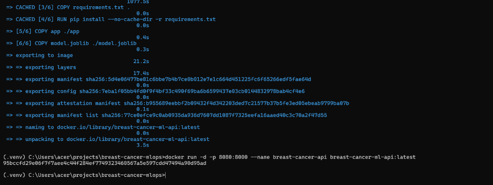
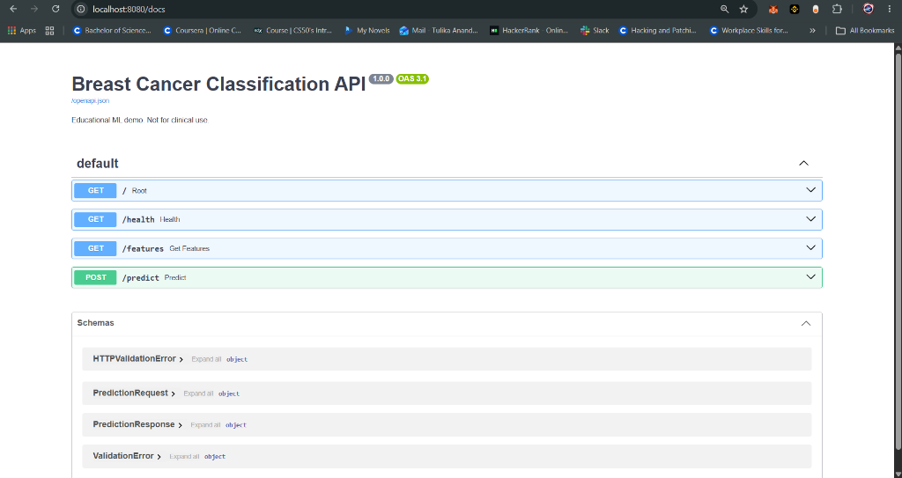
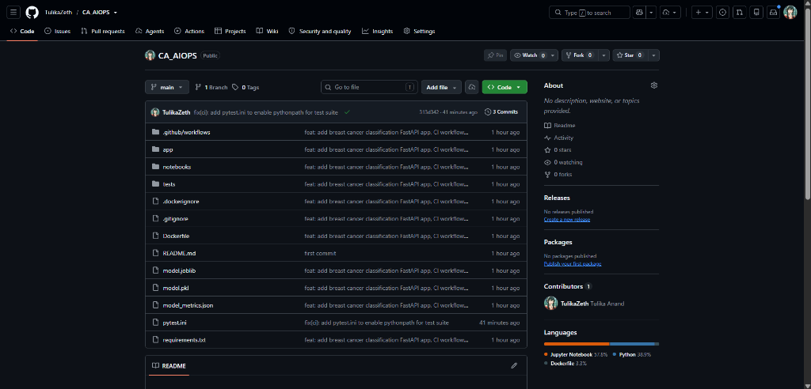

# 🎗️ Breast Cancer Classification — End-to-End MLOps Pipeline

[](https://github.com/flexxy-07/Pipeline_CA2/actions/workflows/ci.yml)
[](https://www.python.org/downloads/release/python-3110/)
[](https://fastapi.tiangolo.com)
[](https://www.docker.com/)
[](LICENSE)

An end-to-end, production-grade **Machine Learning Operations (MLOps)** implementation for breast cancer malignancy prediction using the **Wisconsin Diagnostic Breast Cancer (WDBC)** dataset. The project demonstrates the complete lifecycle: from data exploration and pipeline training to FastAPI microservice packaging, Docker containerization, local orchestration, and automated CI/CD via GitHub Actions.

> [!WARNING]
> **Disclaimer**: This project is built solely for educational and AIOps/MLOps demonstration purposes. It is **not** a certified medical diagnostic device and must never be used for clinical diagnosis or treatment decisions.

---

## 📋 Table of Contents
- [Project Architecture](#-project-architecture)
- [How All 8 Steps Were Achieved](#-how-all-8-steps-were-achieved)
  - [Step 1: Dataset Selection & Exploration](#step-1-dataset-selection--exploration)
  - [Step 2: Model Training & Evaluation (Jupyter / Colab)](#step-2-model-training--evaluation-jupyter--colab)
  - [Step 3: Model Serialization & Artifact Creation](#step-3-model-serialization--artifact-creation)
  - [Step 4: FastAPI REST API Development](#step-4-fastapi-rest-api-development)
  - [Step 5: Automated Test Suite with Pytest](#step-5-automated-test-suite-with-pytest)
  - [Step 6: Containerization with Docker](#step-6-containerization-with-docker)
  - [Step 7: Local Container Execution & Swagger Testing](#step-7-local-container-execution--swagger-testing)
  - [Step 8: CI/CD Pipeline Automation (GitHub Actions)](#step-8-cicd-pipeline-automation-github-actions)
- [Repository Structure](#-repository-structure)
- [Quickstart Guide](#-quickstart-guide)
  - [1. Local Environment Setup](#1-local-environment-setup)
  - [2. Running via Docker](#2-running-via-docker)
- [API Endpoints Reference](#-api-endpoints-reference)
- [Model Performance Metrics](#-model-performance-metrics)

---

## 🏗️ Project Architecture

```
┌────────────────────────┐      ┌─────────────────────────┐      ┌────────────────────────┐
│  Data & Model Training │ ───> │  FastAPI Microservice   │ ───> │ Docker Containerization│
│  (Scikit-Learn Pipeline)│     │  (Validation & Predict) │      │  (Python 3.11-slim)    │
└────────────────────────┘      └─────────────────────────┘      └────────────────────────┘
                                                                              │
                                                                              ▼
┌────────────────────────┐      ┌─────────────────────────┐      ┌────────────────────────┐
│  GitHub Repository     │ ───> │  GitHub Actions CI      │ ───> │ Test & Image Build OK  │
│  (Version Control)     │      │  (Automated Pytest+CI)  │      │ (Green Verified Status)│
└────────────────────────┘      └─────────────────────────┘      └────────────────────────┘
```

---

## 🚀 How All 8 Steps Were Achieved

### Step 1: Dataset Selection & Exploration
- **Dataset**: The **Wisconsin Diagnostic Breast Cancer (WDBC)** dataset (Wolberg, Street, & Mangasarian).
- **Features**: 30 continuous real-valued cellular nuclei measurements (e.g., radius, texture, perimeter, area, smoothness, compactness, concavity, symmetry, fractal dimension across mean, standard error, and worst-case values).
- **Target Variable**: Binary classification:
  - `0`: **Malignant** (Harmful / Cancerous)
  - `1`: **Benign** (Non-cancerous)
- **Reproducibility**: Bundled via Scikit-Learn datasets (`load_breast_cancer(as_frame=True)`) to ensure reproducible training without external API key dependencies.

---

### Step 2: Model Training & Evaluation (Jupyter / Colab)
- **Notebook**: [`notebooks/train_model.ipynb`](notebooks/train_model.ipynb).
- **Train/Test Split**: 80% training (455 samples) and 20% test holdout (114 samples), stratified by label with a fixed `random_state=42`.
- **Pipeline Architecture**:
  1. `SimpleImputer(strategy="median")` — Guarantees robustness against missing feature values.
  2. `StandardScaler()` — Normalizes feature scales for numerical stability and faster gradient convergence.
  3. `LogisticRegression(max_iter=5000, random_state=42)` — High-explainability linear probability classifier.
- **Results**: Delivered **98.25% test accuracy** and **0.9954 ROC-AUC**.

---

### Step 3: Model Serialization & Artifact Creation
- Serialized the complete trained pipeline alongside essential metadata into an encapsulated deployment artifact:
  - `model`: Fitted Scikit-Learn `Pipeline` object.
  - `feature_names`: Exact 30 feature names preserving strict column order.
  - `target_names`: Class labels (`malignant`, `benign`).
  - `class_mapping`: Mapping dictionary (`{"0": "malignant", "1": "benign"}`).
  - `metrics`: Evaluation metrics computed on the test set.
- Persisted in dual formats:
  - [`model.joblib`](model.joblib): Optimized binary format for high-throughput FastAPI inference.
  - [`model.pkl`](model.pkl): Standard Python pickle artifact for backward compatibility.
  - [`model_metrics.json`](model_metrics.json): Human-readable evaluation metrics report.

---

### Step 4: FastAPI REST API Development
- **Implementation**: [`app/main.py`](app/main.py).
- **Framework**: FastAPI + Pydantic v2 for data validation and schema enforcement.
- **Features**:
  - Automatically loads the trained `model.joblib` artifact at application startup.
  - Dynamic route documentation via OpenAPI and Swagger UI (`/docs`).
  - Strict input feature validation: Rejects payloads missing any of the 30 features or containing unexpected extra fields with HTTP 422.
  - Returns predicted class label, integer class code, individual class probabilities, and model baseline metrics.

---

### Step 5: Automated Test Suite with Pytest
- **Test File**: [`tests/test_api.py`](tests/test_api.py).
- **Configuration**: Configured [`pytest.ini`](pytest.ini) with `pythonpath = .` to ensure seamless test execution across both local environments and CI runners.
- **Test Coverage**:
  1. `test_root`: Verifies root URL returns HTTP 200 and points to `/docs`.
  2. `test_health`: Verifies service status is healthy and `model_loaded` is `true`.
  3. `test_features`: Verifies all 30 feature definitions are exposed correctly.
  4. `test_predict_valid_payload`: Validates a complete 30-feature input payload and ensures accurate schema output.
  5. `test_predict_missing_feature_rejected`: Tests error handling when a feature is omitted, asserting HTTP 422 rejection.

---

### Step 6: Containerization with Docker
- **Configuration**: [`Dockerfile`](Dockerfile) and [`.dockerignore`](.dockerignore).
- **Design Decisions**:
  - Base Image: `python:3.11-slim` for a minimal container attack surface and lightweight image size.
  - Environment Variables: `PYTHONDONTWRITEBYTECODE=1` and `PYTHONUNBUFFERED=1` for clean logging and execution.
  - Layer Caching: `requirements.txt` installed prior to copying code layers to leverage Docker cache for faster rebuilds.
  - Production Server: Starts Uvicorn ASGI server binding to `0.0.0.0:8000`.

---

### Step 7: Local Container Execution & Swagger Testing
- **Docker Build**:
  ```bash
  docker build -t breast-cancer-ml-api:latest .
  ```
- **Docker Run**:
  ```bash
  docker run -d -p 8080:8000 --name breast-cancer-api breast-cancer-ml-api:latest
  ```
  *(Host port 8080 mapped to container port 8000 to prevent local host port collisions).*

#### Execution & Swagger UI Verification:
Below is the terminal output confirming successful Docker build and detached container startup:



Below is the live Swagger documentation running at `http://localhost:8080/docs`:



---

### Step 8: CI/CD Pipeline Automation (GitHub Actions)
- **Workflow File**: [`.github/workflows/ci.yml`](.github/workflows/ci.yml).
- **Triggers**: On every `push` and `pull_request` to the `main` or `master` branches.
- **Automated Pipeline Steps**:
  1. **Checkout Repository**: Pulls latest codebase using `actions/checkout@v4`.
  2. **Set up Python 3.11**: Provisions Python environment with pip caching via `actions/setup-python@v5`.
  3. **Install Dependencies**: Installs pinned dependencies from `requirements.txt`.
  4. **Run API Tests**: Executes `pytest -q` to validate application integrity before build.
  5. **Build Docker Image**: Executes `docker build -t breast-cancer-ml-api:ci .` to guarantee container buildability.

#### Continuous Integration Verification:
The workflow passed with 100% green status on commit `313d342`:



---

## 📁 Repository Structure

```text
breast-cancer-mlops/
├── .github/
│   └── workflows/
│       └── ci.yml             # GitHub Actions CI pipeline configuration
├── app/
│   ├── __init__.py
│   └── main.py                # FastAPI prediction application
├── docs/
│   └── images/                # Evidence screenshots for Docker & CI
│       ├── api_swagger_docs.png
│       ├── docker_build_run.png
│       └── github_ci_success.png
├── notebooks/
│   ├── sample_request.json    # Complete 30-feature sample payload for testing
│   └── train_model.ipynb      # Model exploration, training, and export notebook
├── tests/
│   ├── __init__.py
│   └── test_api.py            # Pytest test suite for FastAPI service
├── .dockerignore              # Excluded files for clean Docker builds
├── .gitignore               # Ignored Git artifacts
├── Dockerfile                 # Multi-stage production Dockerfile
├── model.joblib               # Production Scikit-Learn model artifact
├── model.pkl                  # Pickle model artifact
├── model_metrics.json         # Evaluated metrics report
├── pytest.ini                 # Pytest configuration with pythonpath
├── README.md                  # Project documentation
└── requirements.txt           # Python application dependencies
```

---

## 🛠️ Quickstart Guide

### 1. Local Environment Setup

```powershell
# 1. Clone the repository
git clone https://github.com/flexxy-07/Pipeline_CA2.git
cd Pipeline_CA2

# 2. Create and activate a Python 3.11 virtual environment
py -3.11 -m venv .venv
.venv\Scripts\Activate.ps1

# 3. Install dependencies
python -m pip install --upgrade pip
pip install -r requirements.txt

# 4. Run automated test suite
pytest -q

# 5. Launch development server
uvicorn app.main:app --reload --port 8000
```

Access local endpoints:
- Swagger Documentation: [http://localhost:8000/docs](http://localhost:8000/docs)
- Health Status: [http://localhost:8000/health](http://localhost:8000/health)

---

### 2. Running via Docker

```bash
# Build the Docker image
docker build -t breast-cancer-ml-api:latest .

# Run the container (mapping port 8080 to container port 8000)
docker run -d -p 8080:8000 --name breast-cancer-api breast-cancer-ml-api:latest
```

Access container endpoints:
- Swagger Documentation: [http://localhost:8080/docs](http://localhost:8080/docs)
- Health Check: [http://localhost:8080/health](http://localhost:8080/health)

To stop and clean up the container:
```bash
docker stop breast-cancer-api
docker rm breast-cancer-api
```

---

## 📡 API Endpoints Reference

| Method | Endpoint | Description | Sample Output / Status |
| :--- | :--- | :--- | :--- |
| `GET` | `/` | API Information & Docs link | `{"message": "Breast Cancer Classification API", "docs": "/docs"}` |
| `GET` | `/health` | Service health status | `{"status": "healthy", "model_loaded": true}` |
| `GET` | `/features` | Returns list and count of all 30 features | `{"count": 30, "features": [...]}` |
| `POST` | `/predict` | Ingests 30 features, outputs prediction & probabilities | Prediction response schema (see below) |

### Sample Prediction Request (`POST /predict`)
```json
{
  "features": {
    "mean radius": 17.99,
    "mean texture": 10.38,
    "mean perimeter": 122.8,
    "mean area": 1001.0,
    "mean smoothness": 0.1184,
    "mean compactness": 0.2776,
    "mean concavity": 0.3001,
    "mean concave points": 0.1471,
    "mean symmetry": 0.2419,
    "mean fractal dimension": 0.07871,
    "radius error": 1.095,
    "texture error": 0.9053,
    "perimeter error": 8.589,
    "area error": 153.4,
    "smoothness error": 0.006399,
    "compactness error": 0.04904,
    "concavity error": 0.05373,
    "concave points error": 0.01587,
    "symmetry error": 0.03003,
    "fractal dimension error": 0.006193,
    "worst radius": 25.38,
    "worst texture": 17.33,
    "worst perimeter": 184.6,
    "worst area": 2019.0,
    "worst smoothness": 0.1622,
    "worst compactness": 0.6656,
    "worst concavity": 0.7119,
    "worst concave points": 0.2654,
    "worst symmetry": 0.4601,
    "worst fractal dimension": 0.1189
  }
}
```

### Sample Prediction Response
```json
{
  "prediction": "malignant",
  "prediction_code": 0,
  "probabilities": {
    "malignant": 0.999812,
    "benign": 0.000188
  },
  "model_metrics": {
    "accuracy": 0.9825,
    "precision_weighted": 0.9825,
    "recall_weighted": 0.9825,
    "f1_weighted": 0.9825,
    "roc_auc_benign_class": 0.9954
  }
}
```

---

## 📊 Model Performance Metrics

Evaluated on an independent 20% holdout test dataset (114 samples):

| Metric | Score | Note |
| :--- | :---: | :--- |
| **Accuracy** | `98.25%` | Overall classification accuracy |
| **Weighted Precision** | `98.25%` | High true positive rate across classes |
| **Weighted Recall** | `98.25%` | Low false negative rate (critical for healthcare) |
| **Weighted F1-Score** | `98.25%` | Harmonic balance between precision and recall |
| **ROC-AUC (Benign)** | `0.9954` | Exceptional discrimination threshold |